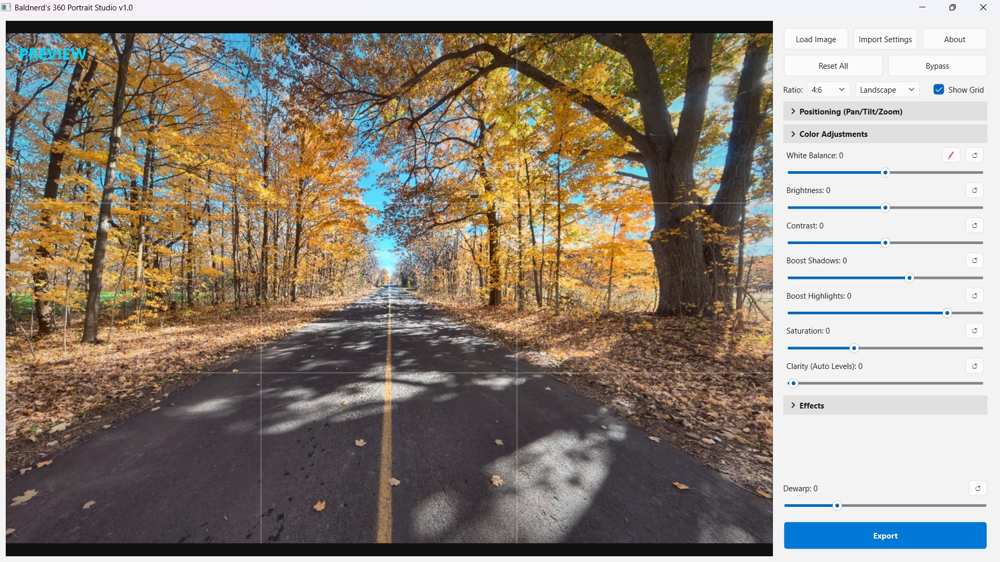
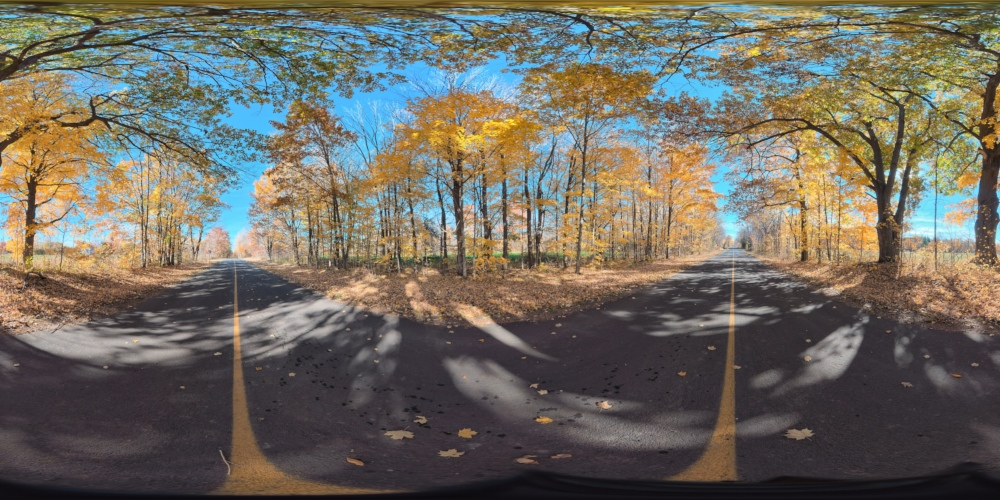

# Baldnerd's 360 Portrait Studio

by Robbie Ferguson // The Bald Nerd

Create beautiful 2D images from 360-degree equirectangular sources.

Whether you've purchased a [DJI OSMO 360 II](https://link.amazon/A0bJE05Ol), an [Insta 360 X6](https://link.amazon/B00bpMqKL) or even the airborne [DJI Avata 360](https://link.amazon/B00bpMqKL) drone, you'll end up with some incredible 360 photos that are difficult to edit or view on traditional displays, and even more difficult to print.

**Baldnerd's 360 Portrait Studio** is a desktop application designed to bridge the gap between immersive 360-degree photography and traditional 2D formats. It allows photographers to load full spherical photos, perfectly frame a specific subject, apply professional-grade color corrections, and export standard, flat images ready for print or social media.

**TURN THIS:**

**INTO THIS:**

## Key Features

**Virtual Camera Framing**
* **Intuitive Controls:** Drag directly on the image to look around, zoom with scroll wheel, use the arrow keys to nudge the camera, or dial in the exact Pan, Tilt, Horizon Roll, and Zoom.
* **Dewarping:** A custom mathematical lens correction that eliminates the unnatural wide-stretching that typically distorts people and objects near the edges of 360-to-2D image conversions.
* **Format Ready:** Includes standard framing guides (4:6, 5:7, 8:10, 16:9, 1:1) with a one-click toggle between Portrait and Landscape orientations.

**Professional Image Enhancement**
* **White Balance:** Using the Eyedropper tool, click any white or neutral gray area in the image to instantly calculate and apply accurate white balance.
* **Improve Color:** Dial in Brightness, Contrast, Shadows, Highlights, and Saturation.
* **Clarity:** An auto-leveling tool that dynamically balances exposure across mixed-lighting scenes.

**Special Effects & Retouching**
* **Noise Reduction & Beautify:** Smooth out high-ISO grain and apply skin softening while preserving hard edges.
* **Sharpen:** Crisp up soft photos with a built-in unsharp mask.
* **Edge Blur & Vignette:** Soften and darken the perimeter of the frame to naturally draw the viewer's eye to the center subject.

**Intelligent Workflow & Performance**
* **Progressive Rendering Engine:** The interface stays fast and fluid by rendering a lightweight proxy image while you move sliders, seamlessly rendering the ultra-high-resolution preview the moment you let go.
* **Instant Bypass:** Hold the `Spacebar` at any time to temporarily bypass all effects and compare your current edit to the raw image.
* **Embedded Presets & Metadata:** The software preserves key EXIF data (GPS, Date Taken, Camera Model). It also embeds your exact slider settings directly into exported JPEG file.
* **Import Settings:** Click "Import Settings" and select any previously exported photo to instantly load its exact look and apply it to your current image. 

**Included Samples**
* Experiment, practice or simply test the tool with provided sample 360 photos in the `samples` folder.
* All sample images are licensed under the terms of the Creative Commons Zero (CC0) dedication, and may be used by anyone for any purpose, commercial or otherwise, without restriction.
* All sample photos are taken by Robbie Ferguson on a DJI OSMO 360 II camera unless otherwise noted.

## Run Baldnerd's 360 Portrait Studio

### Just Download and Run It Like a Pro (Binaries)

* For Windows: [Buy Now](https://www.patreon.com/Category5/posts/download-360-173554469) (Free Perk for Cat5TV Patrons)
* For Linux: [Buy Now](https://www.patreon.com/Category5/posts/download-360-173554469) (Free Perk for Cat5TV Patrons)
* For Mac: Working On It

### Do-It-Yourself Like a L337 H4x0r (Source Code)

1. Ensure Python 3 is installed and you've built your venv.
2. Install the required dependencies:
   `pip install -r requirements.txt`
3. Launch the application:
   `python 360-portrait-studio.py`
