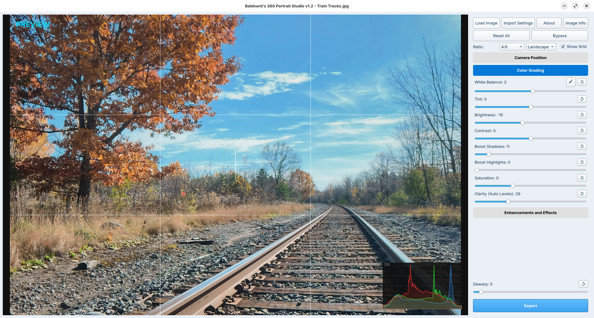
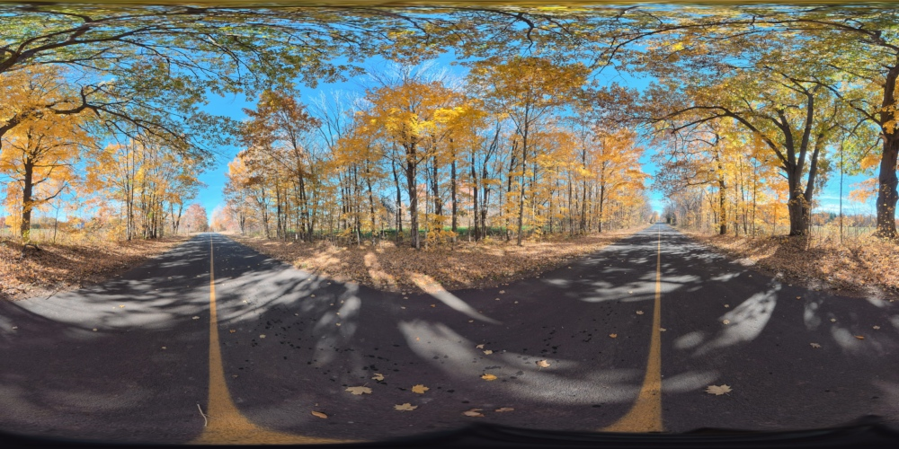

# 📷 Baldnerd's 360 Portrait Studio

**A professional imaging tool to create beautiful 2D images from 360-degree equirectangular sources.**

Created by **Robbie Ferguson** // **The Bald Nerd** // **Category5 TV Network**

---

### 📋 Overview

Whether you've captured footage with a [DJI OSMO 360 II](https://link.amazon/A0bJE05Ol), an [Insta 360 X6](https://link.amazon/B00bpMqKL), or the airborne [DJI Avata 360](https://link.amazon/B00bpMqKL) drone, you end up with incredible 360° captures that are notoriously difficult to edit, view on standard screens, or send to the printer.

| 💡 **Baldnerd To The Rescue** |
| :--- |
| **Baldnerd's 360 Portrait Studio** bridges the gap between immersive 360-degree photography and traditional 2D formats, giving you full creative control over perspective, composition, and finish. |

#### What You Can Do:
* **Frame Any Angle:** Load full equirectangular 360° photos and pull out the exact perspective, crop, and framing you want.
* **Refine & Polish:** Apply professional-grade color corrections tailored for standard display.
* **Export Anywhere:** Produce crisp, flat images optimized for physical print or high-impact social media posts.

## 📦 Official Binaries

Official pre-built binaries are available exclusively on Patreon:

> [!IMPORTANT]
> To ensure you are running safe, unmodified software, and to support my ongoing development efforts as a weekend programmer, please ensure you download and run only official binaries.

---

### Integrity Verification (MD5 Checksums)

#### Release `v1.2`

| OS / Platform | Artifact | MD5 Hash |
| :--- | :--- | :--- |
| **Linux** | `360-portrait-studio-1.2-Linux` | `d9848454a5059c6939815cabd664e0a3` |
| **Windows** | `360-portrait-studio-1.2-Windows.exe` | `3930bdb04fe08778462bd32a2907315f` |
| **macOS** | `360-portrait-studio-1.2-macOS.zip` | `207e0af381f24381dc890b693c74ec07` |

## 🖼️ Screenshots

**TURN THIS:**

**INTO THIS:**

## ✨ Key Features

**Virtual Camera Framing**
* **Intuitive Controls:** Drag directly on the image to look around, zoom with scroll wheel, use the arrow keys to nudge the camera, or dial in the exact Pan, Tilt, Horizon Roll, and Zoom.
* **Dewarping:** A custom mathematical lens correction that eliminates the unnatural wide-stretching that typically distorts people and objects near the edges of 360-to-2D image conversions.
* **Format Ready:** Includes standard framing guides (4:6, 5:7, 8:10, 16:9, 1:1) with a one-click toggle between Portrait and Landscape orientations.

**Professional Image Enhancement**
* **White Balance:** Using the Eyedropper tool, click any white or neutral gray area in the image to instantly calculate and apply accurate white balance.
* **Improve Color:** Dial in Brightness, Contrast, Shadows, Highlights, and Saturation.
* **Clarity:** An auto-leveling tool that dynamically balances exposure across mixed-lighting scenes.
* **RGB Scope:** A waveform-style RGB histogram automatically appears when the Color Grading panel is open, providing real-time visual feedback so you never accidentally crush your shadows or clip your highlights.

**Special Effects & Retouching**
* **Noise Reduction & Beautify:** Smooth out high-ISO grain and apply skin softening while preserving hard edges.
* **Sharpen:** Crisp up soft photos with a built-in unsharp mask.
* **Edge Blur & Vignette:** Soften and darken the perimeter of the frame to naturally draw the viewer's eye to the center subject.

**Intelligent Workflow & Performance**
* **Progressive Rendering Engine:** The interface stays fast and fluid by rendering a lightweight proxy image while you move sliders, seamlessly rendering the ultra-high-resolution preview the moment you let go.
* **Instant Bypass:** Hold the `Spacebar` at any time to temporarily bypass all effects and compare your current edit to the raw image.
* **Embedded Presets & Metadata:** The software preserves key EXIF data (GPS, Date Taken, Camera Model). It also embeds your exact slider settings directly into exported JPEG file.
* **Import Settings:** Click "Import Settings" and select any previously exported photo to instantly load its exact look and apply it to your current image. 
* **Drag-and-Drop Support:** Quickly load new 360 images by dragging and dropping them directly onto the application window.
* **Advanced Image Info:** Click "Image Info" to view hidden image data such as capture details, camera settings, and planned export dimensions. If your photo contains GPS data, a privacy-focused OpenStreetMap link to the exact location is provided.
* **Source Overwrite Protection:** Built-in safety checks block accidental overwriting of original 360 source files or images not created by the software.
* **Digital Asset Manager (DAM):** The "Load Image" feature presents a file browser specially designed for browsing 360 images. The DAM generates 3-frame sprite thumbnails that animate on mouseover, and caches them for faster loading.
* **Smart History & Caching:** Backed by a persistent SQLite database, the app remembers which folders you've visited for instant loading and places a helpful checkmark on photos you've already opened to ease navigating large folders. Fully supports EXIF metadata reading.

**Included Samples**
* Experiment, practice or simply test the tool with provided sample 360 photos in the [samples/360](https://github.com/Cat5TV/360-portrait-studio/tree/main/samples/360) folder.
* Preview sample exports to see what this application is capable of in the [samples/Exports](https://github.com/Cat5TV/360-portrait-studio/tree/main/samples/Exports) folder.
* All sample images are licensed under the terms of the Creative Commons Zero (CC0) dedication, and may be used by anyone for any purpose, commercial or otherwise, without restriction.
* All sample photos are taken by Robbie Ferguson on a DJI OSMO 360 II camera unless otherwise noted.

## 💾 Cache and Database Location

This folder stores the compressed thumbnail sprites and the history database which tells the Load Image window which files have already been opened (and adds a checkmark to the ones that have).

* Windows: %LOCALAPPDATA%\Baldnerds360PortraitStudio
* Linux: ~/.local/share/Baldnerds360PortraitStudio
* macOS: ~/Library/Application Support/Baldnerds360PortraitStudio

With Baldnerd's 360 Portrait Studio closed, you can safely delete the cache folder if desired.

## 💻 Run Baldnerd's 360 Portrait Studio

### Download and Run It Like a Pro (Binaries)

* For Windows: [Buy Now](https://www.patreon.com/Category5/posts/download-360-173554469) (Free Perk for Cat5TV Patrons)
* For Linux: [Buy Now](https://www.patreon.com/Category5/posts/download-360-173554469) (Free Perk for Cat5TV Patrons)
* For Mac: [Buy Now](https://www.patreon.com/Category5/posts/download-360-173554469) (Free Perk for Cat5TV Patrons)

### Do-It-Yourself Like a L337 H4x0r (Source Code)

1. Ensure Python 3 is installed and you've built your venv.
2. Install the required dependencies:
   `pip install -r requirements.txt`
3. Launch the application:
   `python 360-portrait-studio.py`
